# Novend POS

Commercial offline-first Point of Sale and business management platform
(**Nova + Vend**). Multi-tenant POS for independent retail, wholesale, pharmacy,
fashion, electronics, and convenience businesses.

Built by [Asiedu Development Hub](https://github.com/asiedudev).

<p align="center">
  
</p>

See [`overview.md`](./overview.md) for product vision and
[`docs/PROJECT_CONSTITUTION.md`](./docs/PROJECT_CONSTITUTION.md) for engineering
authority. Public product docs (with interactive screenshots) live at `/docs` in
the running app.

## Product tour

| App dashboard | Mobile / tablet web |
|-------------|---------------------|
| 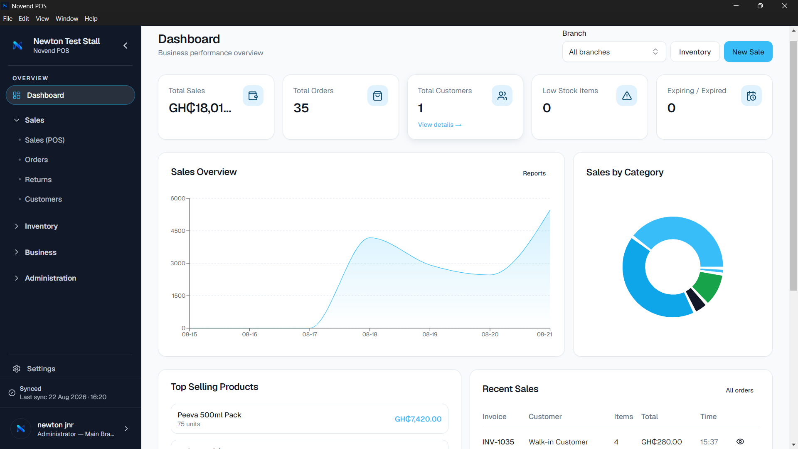 |  |

### Get started

| Sign up | Onboarding | Dashboard |
|---------|------------|-----------|
| 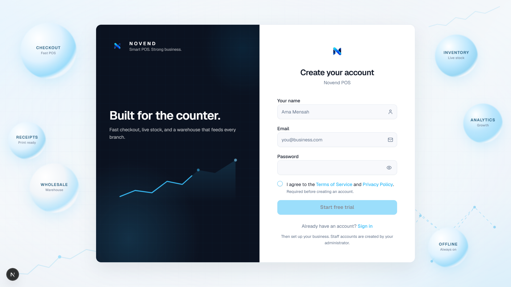 | 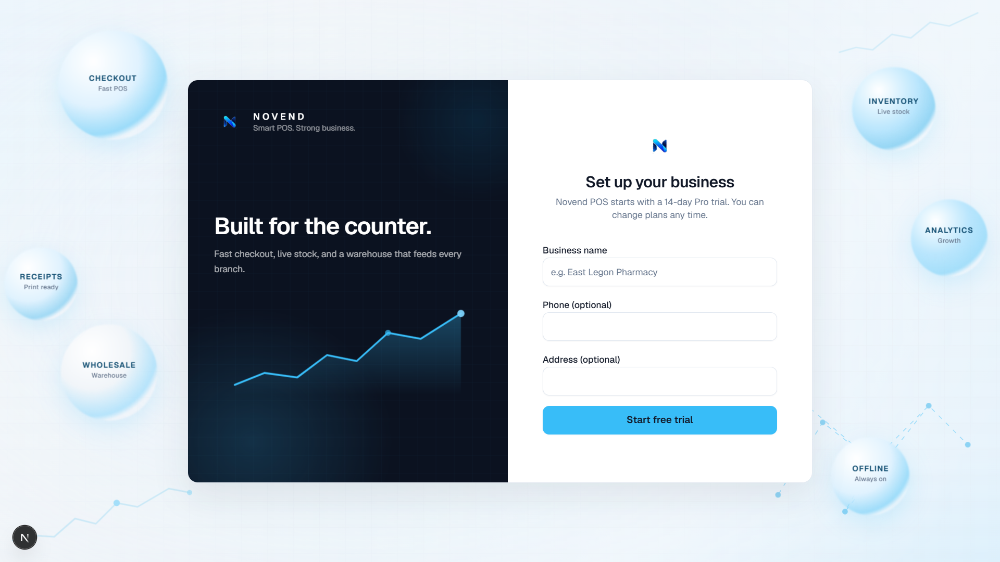 |  |

### Sell & manage stock

<p align="center">
  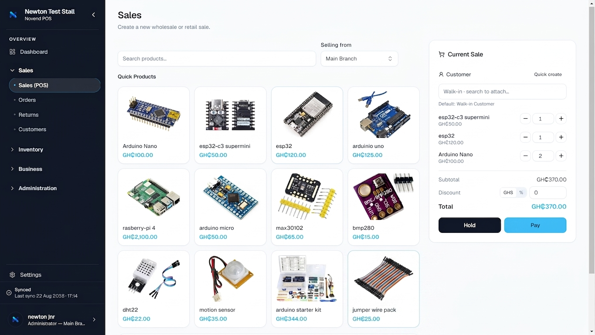
</p>

| Inventory | Wholesale | Analytics |
|-----------|-----------|-----------|
| 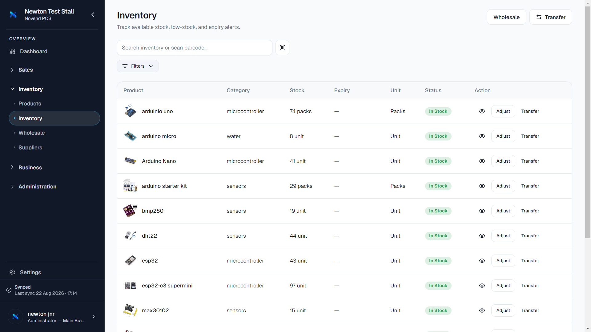 | 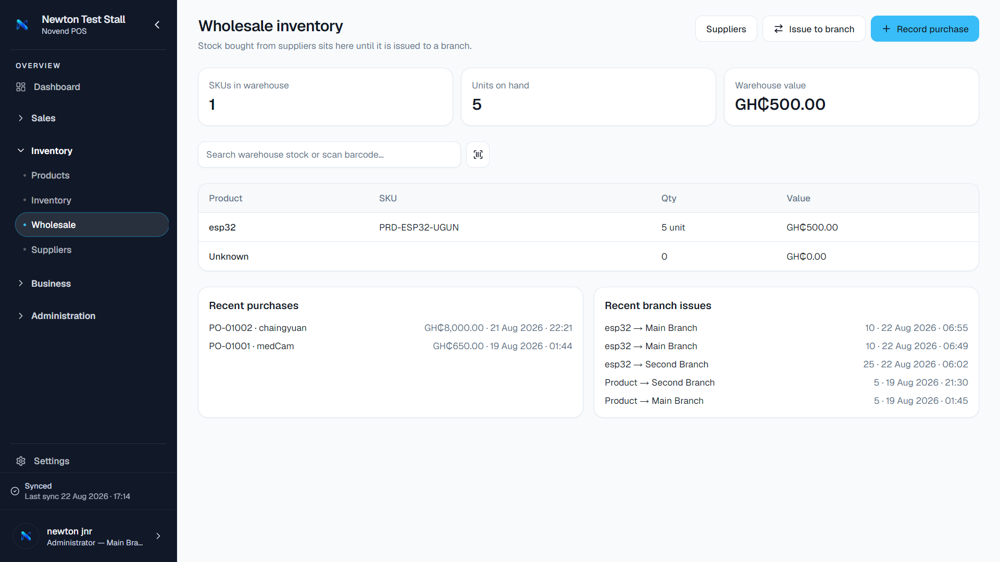 | 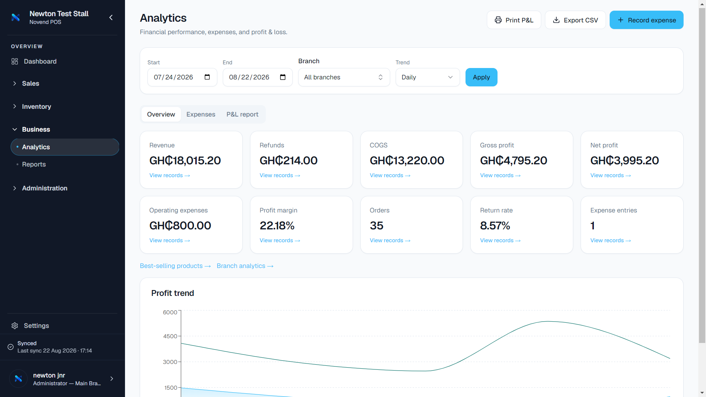 |

### Built for every kind of retail

| Pharmacy | Supermarket | Wholesale |
|----------|-------------|-----------|
| 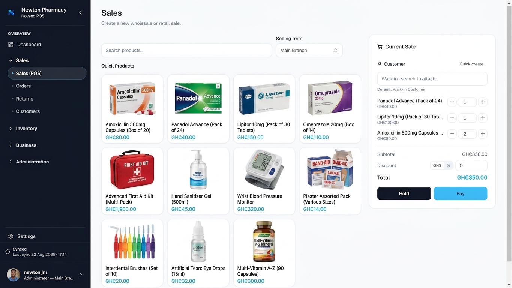 | 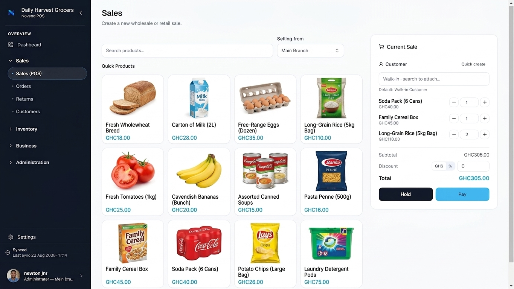 | 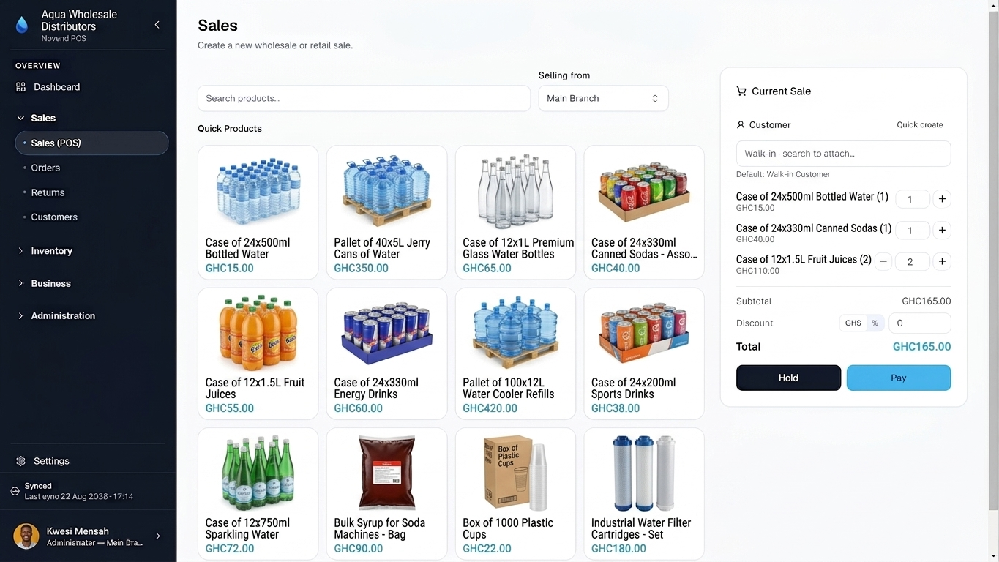 |

| Fashion | Electronics | Convenience |
|---------|-------------|-------------|
| 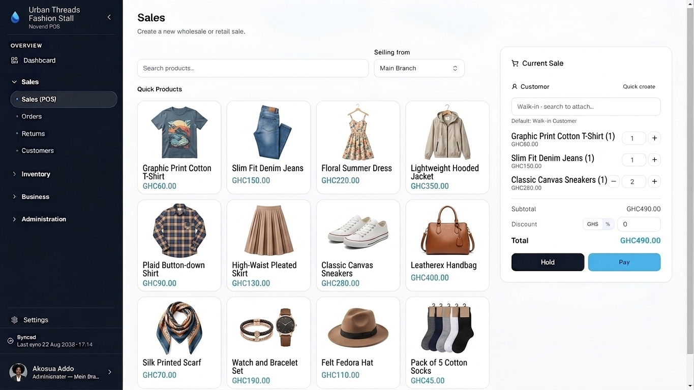 | 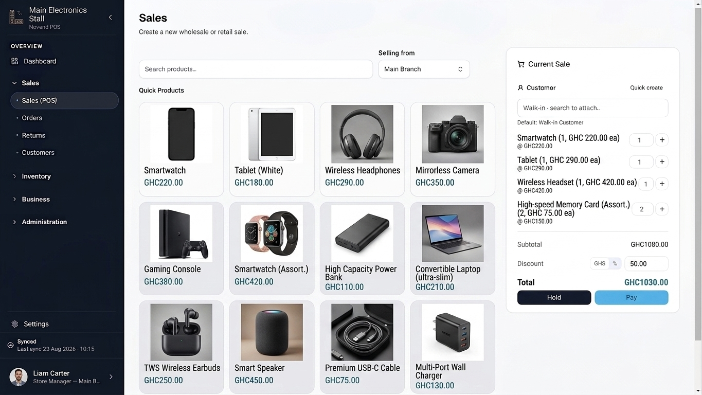 | 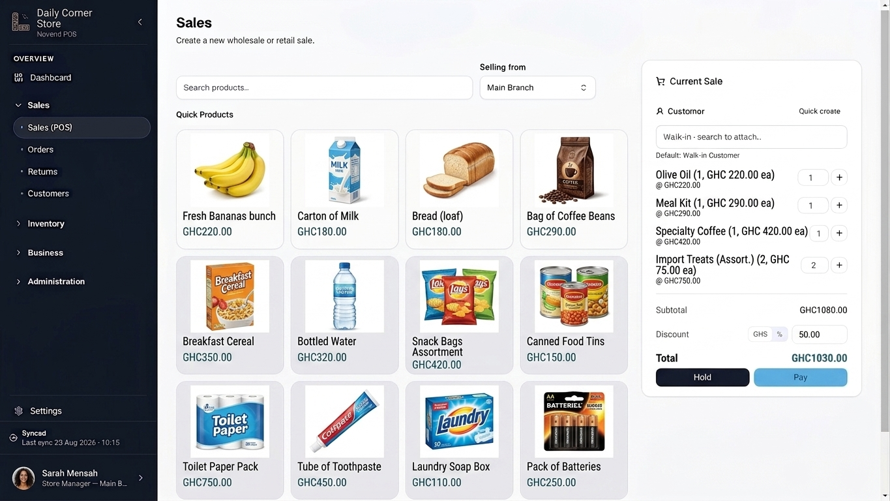 |

More UI captures: [`docs/design/ui/README.md`](./docs/design/ui/README.md).

## What you get

- Offline-first checkout with cloud sync when the network returns
- Inventory, wholesale storage, branch transfers, and adjustments with history
- Customers, suppliers, returns, analytics, and printable reports
- Desktop installers (Windows / macOS / Linux) plus web — mobile apps on the roadmap
- Roles for cashier, manager, administrator, and owner — always organization-scoped

## Stack

Next.js · Convex · TypeScript · Tailwind CSS · Dexie · pnpm

## Develop

```bash
pnpm install
npx convex dev
pnpm dev
```

Copy `.env.example` to `.env.local`. Convex codegen (`convex/_generated`) is
refreshed by `npx convex dev`.

First-time flow: **sign up → onboard your business → add products → sell**.

## Documentation map

| Doc | Purpose |
|-----|---------|
| [`docs/PROJECT_CONSTITUTION.md`](./docs/PROJECT_CONSTITUTION.md) | Engineering authority |
| [`docs/PROJECT_CONTEXT.md`](./docs/PROJECT_CONTEXT.md) | Product context |
| [`docs/FOLDER_STRUCTURE.md`](./docs/FOLDER_STRUCTURE.md) | Code ownership |
| [`docs/business/SALES_WORKFLOW.md`](./docs/business/SALES_WORKFLOW.md) | POS sell flow |
| [`docs/business/INVENTORY_WORKFLOW.md`](./docs/business/INVENTORY_WORKFLOW.md) | Stock movements |
| [`docs/architecture/OFFLINE_SYNC.md`](./docs/architecture/OFFLINE_SYNC.md) | Local-first sync |
| [`docs/design/ui/README.md`](./docs/design/ui/README.md) | Screenshot index |
