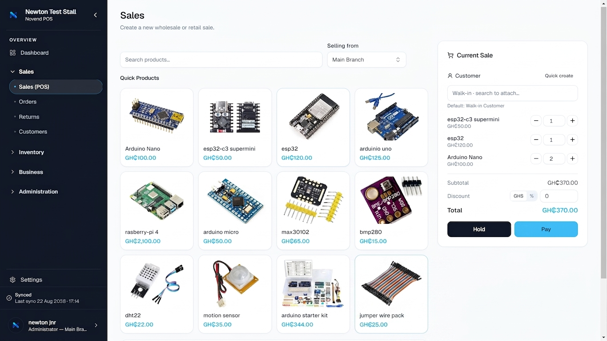

# Novend POS

## Project Context

Version: 1.1.1

# Purpose

Operational and product context for Novend POS. Read alongside the Constitution.

# Product

**Brand:** Novend (Nova + Vend)
**Developer:** Asiedu Development Hub
**Type:** Commercial SaaS / deployable POS, inventory, and business management

Novend is the commercial evolution of Princellen POS: one codebase serving many
independent businesses rather than one dedicated wholesaler.

# Who it is for

Retail shops, wholesale distributors, pharmacies, electronics, fashion, hardware,
convenience stores, and other product-based businesses — including multi-branch
organizations.

# Product screens (GitHub)

| Flow         | Capture                                                                    |
| ------------ | -------------------------------------------------------------------------- |
| Landing      | [`design/ui/desktop_fullpage.png`](./design/ui/desktop_fullpage.png)       |
| Sign up      | [`design/ui/auth-signup.png`](./design/ui/auth-signup.png)                 |
| Onboarding   | [`design/ui/business-onboarding.png`](./design/ui/business-onboarding.png) |
| Dashboard    | [`design/ui/dashboard.png`](./design/ui/dashboard.png)                     |
| Mobile shell | [`design/ui/mobile_fullpage.png`](./design/ui/mobile_fullpage.png)         |

Index: [`design/ui/README.md`](./design/ui/README.md).

# What a customer can do

1. Create an account (accept Terms & Privacy)
2. Create their business (organization + MAIN branch)
3. Add staff
4. Add categories and products (including CSV/Excel catalog import)
5. Receive / adjust stock; wholesale and transfers where enabled
6. Sell at the POS
7. Print a receipt
8. Complete a sale while offline (after an online login), then sync
9. Review orders, returns, customers, analytics, and export reports as entitled

# Stakeholders

| Role                    | Need                                                   |
| ----------------------- | ------------------------------------------------------ |
| Organization owner      | Bootstrap the business, manage staff and settings      |
| Administrator / manager | Catalog, inventory, oversight                          |
| Cashier                 | Fast, reliable selling                                 |
| Engineer                | Clear architecture, tenant isolation, documented rules |

# Deployment targets

- **Web** — browsers and tablets
- **PWA** — iOS Home Screen install; service worker for offline shell
- **Desktop (Electron)** — Windows / macOS / Linux installers via Downloads
- **Android** — native app via Downloads (Capacitor)

# Success for the business

Two organizations on one deployment cannot see each other’s data.
A cashier can complete a sale online and offline. Inventory never goes negative.
The UI follows Novend branding (Candy Blue, Onyx, Cloud White).
