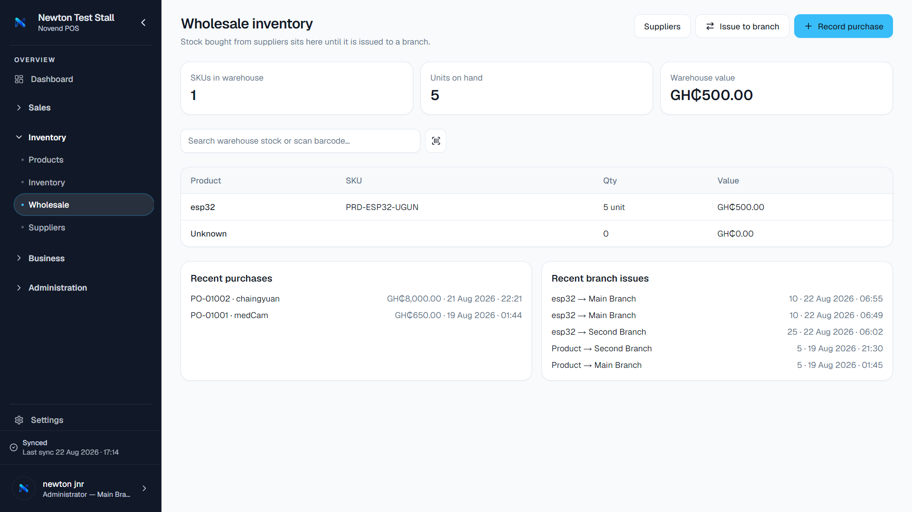
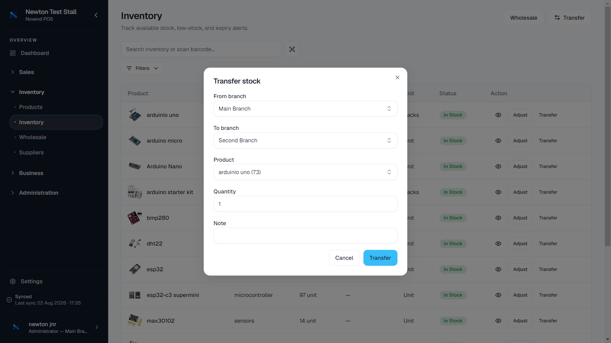

# Inventory Workflow

Version: 1.2.2

## Rules

- Stock lives on `branchStock` (and lots when expiry is tracked)
- Quantity cannot go negative
- Every change writes `inventoryHistory` with a reason
- Reasons in this slice: `sale`, `receive`, `adjustment`, `damage`, `expiry`, `seed`
- Receive increases stock; adjustment/damage/expiry decrease or correct
- Cashiers cannot receive or adjust

## Flow

1. Open Inventory
2. Search / filter by status
3. Receive or remove stock with **Add stock** / **Remove stock** and a typed
   quantity (phone keypads have no minus key). Optional lot expiry when adding.
4. Adjust with a note
5. On the product page, administrators and managers can change each lot’s
   expiry date (offline queues `update_lot_expiry`; same-date lots merge)
6. History remains the audit trail

## Wholesale receive

Administrators and managers record supplier purchases on Wholesale. Each line
stores quantity, **cost**, and **selling** price; those prices become the
product catalog so issue-to-branch uses the new sell price. A new SKU can be
created from the purchase dialog (zero branch stock); warehouse quantity is
added when the purchase is saved.

## Related screenshots

Wholesale issue / receive modals and product detail (including expiry) are listed
in [`../design/ui/README.md`](../design/ui/README.md).
