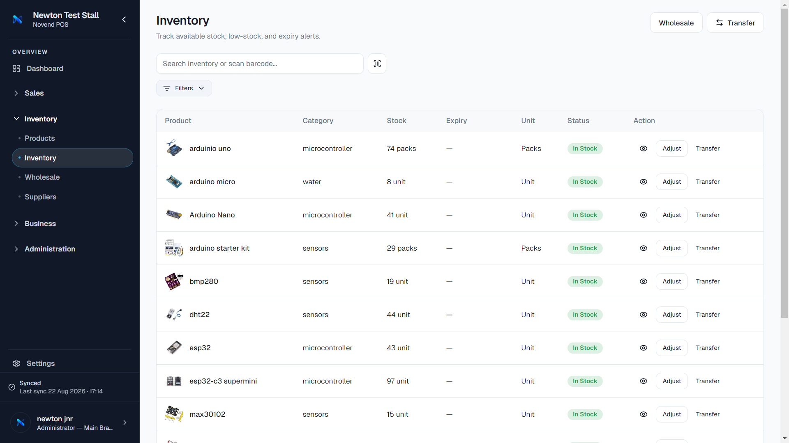
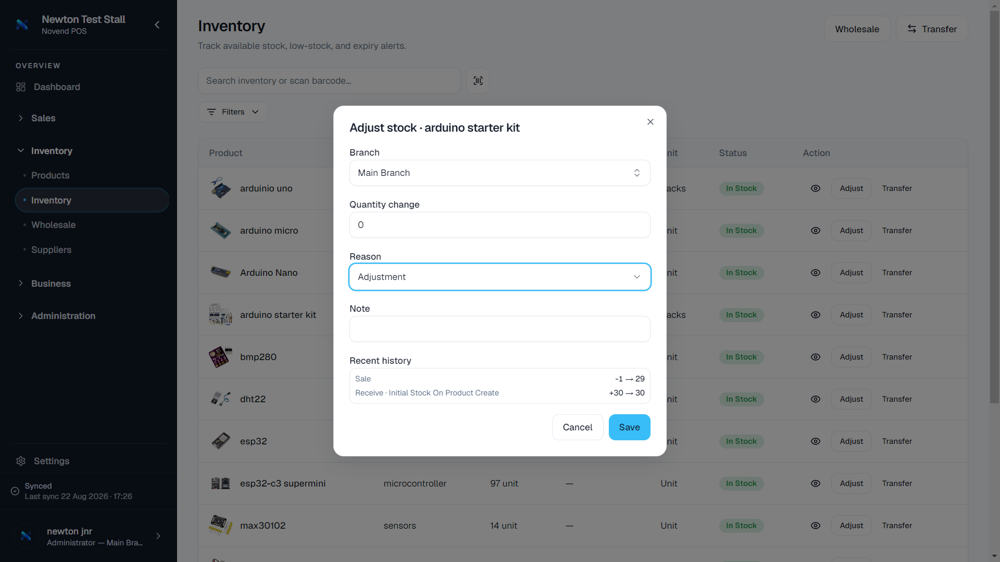

# Inventory Workflow

Version: 1.1.0

## Rules

- Stock lives on `branchStock` (and lots when expiry is tracked)
- Quantity cannot go negative
- Every change writes `inventoryHistory` with a reason
- Reasons in this slice: `sale`, `receive`, `adjustment`, `damage`, `expiry`, `seed`
- Receive increases stock; adjustment/damage/expiry decrease or correct
- Cashiers cannot receive or adjust

## Flow

1. Open Inventory
2. Search / filter by status
3. Receive stock (optional lot expiry)
4. Adjust with a note
5. History remains the audit trail

## Related screenshots

Wholesale issue / receive modals and product detail (including expiry) are listed
in [`../design/ui/README.md`](../design/ui/README.md).
