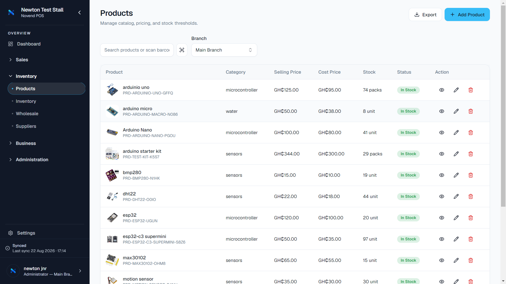
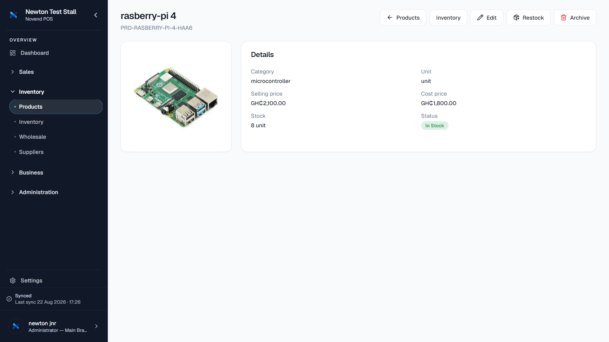

# Product Workflow

Version: 1.1.0

## Rules

- Categories are admin-managed
- SKU unique per organization
- Status: `active` | `inactive` | `archived` (prefer archive over delete)
- Cost price is visible to administrator and manager only
- Optional `tracksExpiry` enables lots + FEFO at checkout

## Flow

1. Ensure a category exists
2. Create product (name, SKU, prices, unit, threshold, image)
3. Receive opening stock on Inventory
4. Active products with sellable stock appear on the POS

## Related screenshots

Expiry-oriented product detail: `inventory-product-detail-expiry.png` in
[`../design/ui/README.md`](../design/ui/README.md).
