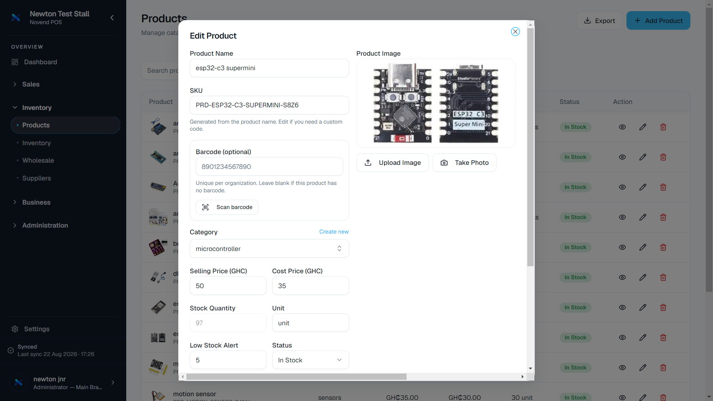

# Product Workflow

Version: 1.1.1

## Rules

- Categories are admin-managed
- SKU unique per organization
- Status: `active` | `inactive` | `archived` (prefer archive over delete)
- Cost price is visible to administrator and manager only
- Optional `tracksExpiry` enables lots + FEFO at checkout
- Existing lot expiry dates are edited per batch on the product page, not in
  the add/edit product dialog
- With `product_variants`, a **parent** is catalog-only; each **child** variant
  has its own SKU, barcode, price, and branch stock. Parents never appear as
  sellable POS lines.
- With `serial_tracking`, products marked `tracksSerials` require one unique
  serial per base unit at checkout.
- With `custom_fields`, free-form key/value attributes can be stored on the product.

## Flow

1. Ensure a category exists
2. Create product (name, SKU, prices, unit, threshold, image)
3. Optional: mark as variant parent, then create child variants with attributes
4. Receive opening stock on Inventory (children / non-parents only)
5. Active sellable products with stock appear on the POS

## Related screenshots

Expiry-oriented product detail: `inventory-product-detail-expiry.png` in
[`../design/ui/README.md`](../design/ui/README.md).
