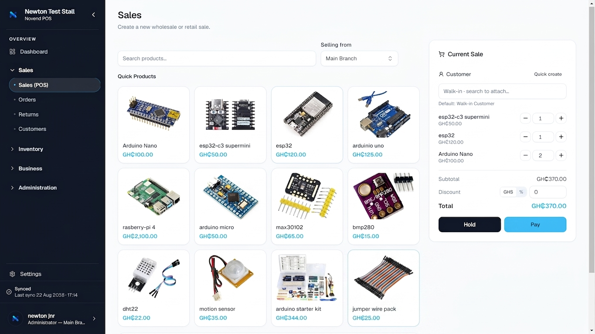
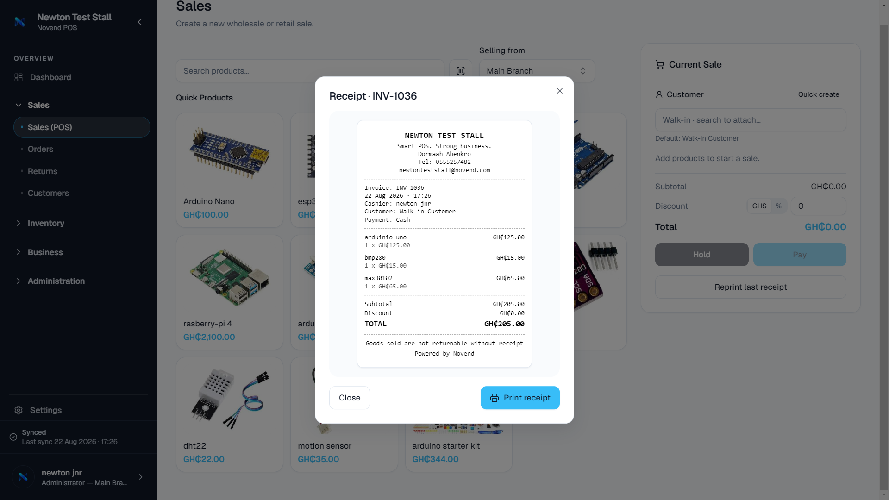
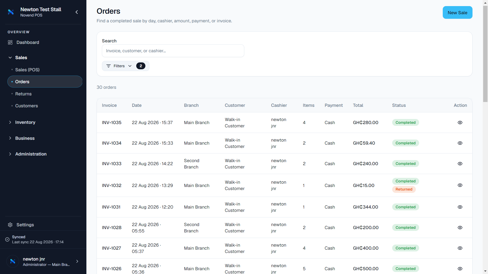

# Sales Workflow

Version: 1.1.3

Cashier POS: build a cart, optional customer, Hold or Pay. Completed sales are
immutable and print a receipt.

## Rules

- Only `active` products with sellable stock > 0 appear in the catalog
- Product cards show on-hand stock (and unit) on Sales so cashiers do not open Inventory to check quantity
- Cart quantities cannot exceed sellable stock
- Dated products allocate lots FEFO; expired units cannot be sold
- Customer defaults to Walk-in
- Pay writes `sales` + `saleItems` + `receipts` and decrements inventory
- Completed sales are immutable
- Hold stores the cart; inventory is not reduced until checkout
- Payments are stored per tender in `salePayments`; the lines must equal the
  sale total and the largest tender is the sale's primary payment method
- On-account tender needs a customer, the `customer_credit` capability, and
  stays within the customer's credit limit; it writes a ledger charge
- Receipts list every tender when a sale is split or on account
- Offline checkout writes Dexie + outbox, then syncs with `clientOperationId`
- The invoice printed on the receipt is the permanent invoice number (sync does not replace it)
- The working cart (items, discount, customer) is kept in the tab per cashier
  and branch so leaving Sales and returning restores it. Checkout, hold, and
  sign-out clear it.

## Flow

1. Open Sales
2. Optionally attach or create a customer
3. Search or tap products
4. When multi-unit pricing is enabled and a product has more than one sell unit
   (piece / pack / carton), choose the unit before it enters the cart. Scanning a
   sell-unit barcode adds that unit directly.
5. Adjust quantities; optional discount
6. Hold, or Pay. Cash / card / mobile money are one-tap shortcuts; **Split
   payment** takes several tenders that must add up to the total. **On account**
   appears when customer credit is enabled and a named customer is selected (see
   [`CUSTOMERS_CREDIT_WORKFLOW.md`](./CUSTOMERS_CREDIT_WORKFLOW.md)). When
   customer price lists are enabled, the customer's group rules reprice the cart
   as soon as the buyer is selected and again when the sale is saved.
7. Print receipt

## Related screenshots

See [`../design/ui/README.md`](../design/ui/README.md) for the full capture index
(industry POS variants, returns, customers).
