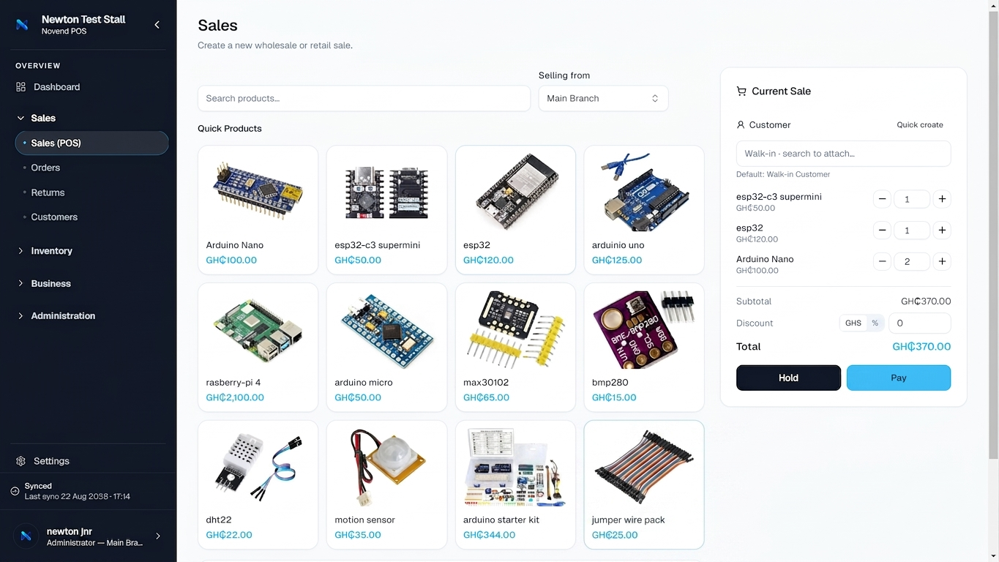
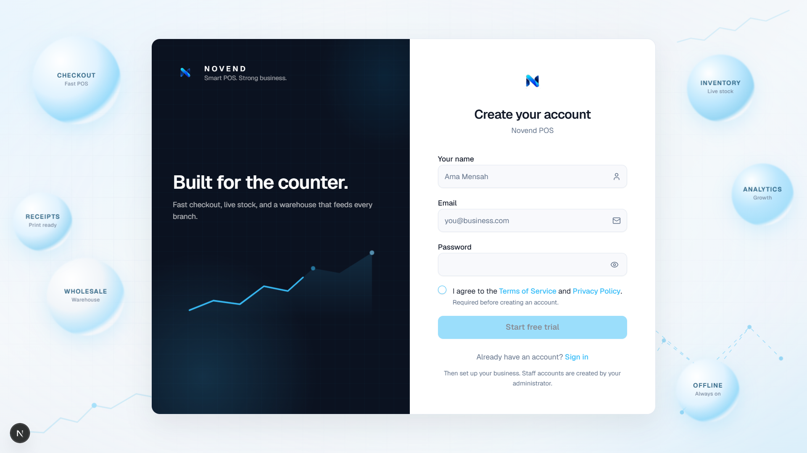
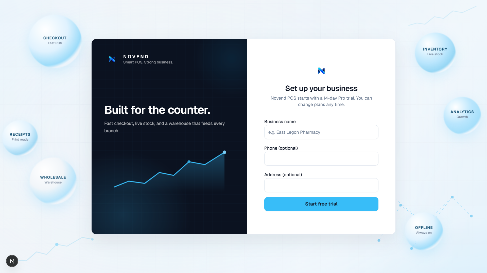
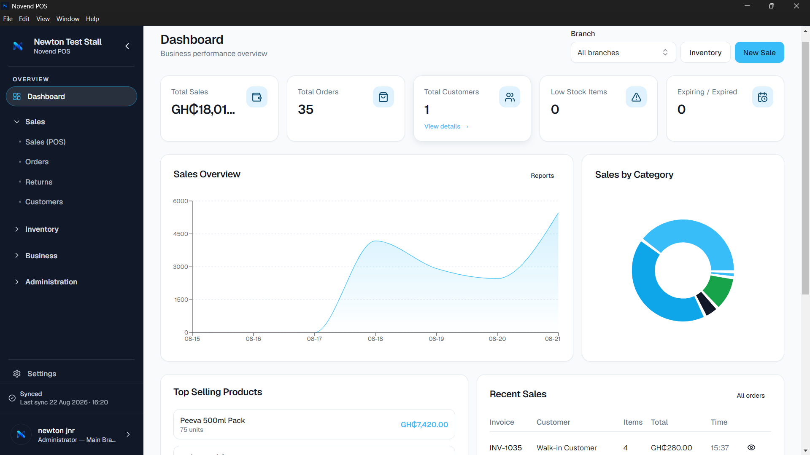

# Novend POS — Commercial Offline-First Point of Sale & Business Management Platform

**Brand Name:** Novend
**Brand Meaning:** **Nova (New) + Vend (Selling)**
**Product Type:** Commercial Offline-First Point of Sale, Inventory & Business Management System
**Developed By:** Asiedu Development Hub
**Product Line:** Commercial SaaS / Deployable Business Software

---

## 1. Executive Summary

**Novend POS** is a modern commercial Point of Sale and business management platform built as the commercial evolution and replication of the **Princellen POS architecture**.

Princellen POS was designed around the operational needs of a specific wholesaler/distributor. Novend takes the proven concepts, workflows, architecture, and functionality of that system and transforms them into a **general-purpose commercial product that can be used by any business**.

Novend is designed for:

- Retail shops
- Supermarkets
- Wholesale businesses
- Pharmacies
- Electronics stores
- Fashion stores
- Cosmetics shops
- Hardware stores
- Convenience stores
- Stationery shops
- Multi-branch businesses
- Other product-based businesses

The fundamental idea is simple:

> **Every business should be able to get its own Novend POS system and operate its business independently.**

Each customer gets their own business environment containing their products, inventory, branches, employees, customers, suppliers, sales, expenses, returns, reports, settings, and business data.

Novend is therefore not a custom POS built for one company.

It is a **commercial POS platform designed to serve many independent businesses from the same product and codebase.**

<p align="center">
  
</p>

<p align="center">
  
</p>

| Sign up                                                                | Onboarding                                                                        | Dashboard                                                              |
| ---------------------------------------------------------------------- | --------------------------------------------------------------------------------- | ---------------------------------------------------------------------- |
|  |  |  |

Full screenshot index: [`docs/design/ui/README.md`](./docs/design/ui/README.md).

---

# 2. Brand Identity

## Novend

### Nova + Vend

**Nova** represents:

- New
- Modern
- Fresh
- Innovation
- Transformation

**Vend** represents:

- Selling
- Commerce
- Retail
- Transactions
- Point of Sale

Together:

> **Novend = Nova + Vend = New Selling**

The name represents a modern approach to running and managing a commercial business.

### Brand Position

Novend should communicate:

**Modern commerce. Simple operations. Reliable selling.**

The product should feel suitable for both a small retail shop and a growing multi-branch enterprise.

---

# 3. Product Vision

## Primary Vision

Build a modern commercial POS platform where businesses can manage their entire day-to-day operation from one system while remaining productive even when the internet is unavailable.

Novend is designed around the principle:

> **Internet should enhance the business, not control it.**

A shop should still be able to:

- Sell products
- Process payments
- Print receipts
- Search products
- Manage inventory
- Handle customers
- Process returns
- Record expenses

even when the internet connection is unavailable.

---

# 4. Novend as a Commercial Product

The biggest difference between Princellen POS and Novend is **productization**.

### Princellen POS

Princellen was essentially a dedicated business solution designed around one organization's operational requirements.

### Novend POS

Novend takes the same proven foundation and turns it into a reusable commercial platform.

A new customer should be able to:

1. Create an account.
2. Create their business.
3. Configure their store.
4. Add branches.
5. Add employees.
6. Add products.
7. Configure payment methods.
8. Start selling.

Every business operates within its own isolated organization environment.

For example:

**Business A**

> ABC Pharmacy

**Business B**

> Asiedu Electronics

**Business C**

> Bright Fashion

**Business D**

> Kofi's Supermarket

All four businesses can use Novend while maintaining completely separate business data.

---

# 5. Multi-Tenant Commercial Architecture

Novend is designed as a **multi-tenant commercial platform**.

The organization is the primary business boundary.

```text
Novend Platform
│
├── Organization A
│   ├── Users
│   ├── Branches
│   ├── Products
│   ├── Inventory
│   ├── Sales
│   ├── Customers
│   └── Reports
│
├── Organization B
│   ├── Users
│   ├── Branches
│   ├── Products
│   ├── Inventory
│   ├── Sales
│   ├── Customers
│   └── Reports
│
└── Organization C
    ├── Users
    ├── Branches
    ├── Products
    ├── Inventory
    ├── Sales
    ├── Customers
    └── Reports
```

Each organization's data is logically isolated.

The Novend platform provides the infrastructure while each customer operates their own independent business environment.

---

# 6. Offline-First Philosophy

Novend follows a strict **Offline-First Architecture**.

The POS does not require a continuous internet connection to perform critical business operations.

The local device is capable of operating independently.

### Normal Sale Lifecycle

```text
Cashier creates sale
        ↓
Sale saved locally
        ↓
Inventory updated locally
        ↓
Payment recorded locally
        ↓
Receipt generated
        ↓
Receipt printed
        ↓
Sale added to sync queue
        ↓
Internet becomes available
        ↓
Sync Engine synchronizes changes
        ↓
Cloud backup updated
```

The cashier does not wait for a cloud API before completing the transaction.

This is particularly important for businesses operating in environments with:

- Unstable internet
- Expensive data
- Network outages
- Power interruptions
- Rural connectivity limitations
- Temporary ISP failures

---

# 7. System Architecture

Novend is divided into several major layers.

| Layer               | Responsibility                                         |
| ------------------- | ------------------------------------------------------ |
| Next.js Application | User interface and application experience              |
| Business Logic      | POS, inventory and business workflows                  |
| IndexedDB / Dexie   | Local operational database                             |
| Repository Layer    | Local data access abstraction                          |
| Sync Engine         | Offline synchronization and conflict management        |
| Convex              | Cloud synchronization, backup and remote data services |
| Electron            | Desktop app (Windows, macOS, Linux)                    |
| Capacitor           | Native Android app                                     |
| PWA                 | iOS Home Screen install                                |

### Important Architectural Principle

**IndexedDB is the operational database.**

Convex is **not** the database that cashiers depend on during normal operation.

The cloud layer exists primarily for:

- Synchronization
- Backup
- Multi-device coordination
- Remote access
- Business monitoring
- Disaster recovery

---

# 8. Supported Platforms

## Web Application

Novend can run directly inside modern browsers.

Supported environments include:

- Chrome
- Microsoft Edge
- Firefox
- Safari

The web application provides the complete business management experience.

---

## Desktop Application

Novend can also be distributed as an Electron desktop application.

Desktop capabilities include:

- Offline storage
- Thermal printer integration
- Receipt printing
- Local file backup
- Hardware integration
- Automatic updates
- Improved POS experience

Windows is the primary counter target. macOS and Linux installers ship from the same Downloads page.

---

## Android app

Novend ships a native Android app (Capacitor) from Downloads. It uses the same account, catalog, Dexie cache, and Convex sync as desktop and web.

## iOS (PWA)

On iPhone and iPad, add Novend to the Home Screen from Safari as a Progressive Web App. A native App Store client is not published yet.

Mobile functionality includes:

- Product lookup
- Barcode scanning
- Inventory checking
- Mobile sales
- Customer lookup
- Stock management
- Business monitoring

One Next.js codebase serves web, PWA, desktop, and Android — native shells add hardware and installers, not a second product.

---

# 9. Core Business Modules

## 9.1 Point of Sale

The POS is the heart of Novend.

Designed for fast cashier operations.

### Features

- Product search
- Barcode scanning
- Category browsing
- Cart management
- Manual quantity entry
- Quantity adjustment
- Discounts
- Tax calculation
- Multiple payment methods (one method per sale)
- Held sales
- Resume held sales
- Customer assignment
- Receipt generation
- Receipt printing
- Sales notes

The POS remains operational offline.

---

# 10. Inventory Management

Novend provides enterprise-capable inventory management while remaining simple enough for small businesses.

### Product Management

- Product creation
- Product editing
- Product deletion
- SKU
- Barcode
- Product images
- Categories
- Brands
- Units
- Cost price
- Selling price
- Wholesale price
- Tax configuration
- Stock threshold
- Product status

### Inventory

- Current stock
- Stock adjustments
- Stock transfers
- Stock valuation
- Low-stock alerts
- Out-of-stock alerts
- Inventory history
- Stock movement tracking
- Branch-specific inventory

---

# 11. Purchase Management

Businesses can manage the process of bringing stock into the organization.

### Features

- Suppliers
- Purchase orders
- Purchase records
- Goods received
- Supplier invoices
- Purchase costs
- Stock increases
- Purchase history

Purchases directly affect inventory.

---

# 12. Customer Management

Novend provides a centralized customer database.

### Customer Features

- Customer profiles
- Phone number
- Email
- Address
- Notes
- Purchase history
- Loyalty information
- Customer-specific pricing where supported

Customers can be organization-wide while transactions remain associated with the relevant branch.

---

# 13. Supplier Management

Businesses can maintain complete supplier records.

### Features

- Supplier profiles
- Contact information
- Products supplied
- Purchase history
- Supplier transactions
- Supplier performance information

---

# 14. Returns Management

Returns are treated as a dedicated business module rather than being hidden inside the sales system.

## Full Return

A complete sale can be returned with a single action.

## Partial Return

A cashier or authorized employee can select specific products and quantities.

For example:

```text
Original Sale
────────────────────
Rice       5
Milk       3
Bread      2

Customer returns:
Milk       2
Bread      1
```

Novend records the exact returned quantities.

### Every Return Records

- Original sale
- Returned items
- Returned quantities
- Refund amount
- Return reason
- Staff member
- Branch
- Timestamp
- Payment/refund method

This creates a complete audit trail.

---

# 15. Expense Management

Businesses can record operational expenses.

Examples:

- Electricity
- Water
- Rent
- Fuel
- Salaries
- Transportation
- Maintenance
- Internet
- Repairs
- Miscellaneous expenses

Expenses are incorporated into financial reporting and profitability calculations.

---

# 16. Multi-Branch Management

Novend supports both single-store and multi-branch businesses.

A customer does not need multiple systems when their business expands.

They can simply add another branch.

### Each Branch Can Have

- Employees
- Inventory
- Sales
- Expenses
- Customers
- Receipt configuration
- Cash management
- Branch reports

### Stock Transfers

Authorized users can transfer stock between branches.

```text
Branch A
   │
   │ Stock Transfer
   ↓
Branch B
```

The transfer is recorded as a traceable inventory event.

---

# 17. User Management & RBAC

Novend includes role-based access control.

### Super Admin

Complete organization control.

Can manage:

- Organization
- Branches
- Users
- Products
- Inventory
- Sales
- Purchases
- Customers
- Suppliers
- Expenses
- Reports
- Settings

### Admin

Business management capabilities.

### Manager

Access limited to assigned branches and authorized operations.

### Cashier

Focused on:

- POS
- Sales
- Customers
- Returns where permitted
- Assigned cashier operations

Permissions should be granular rather than relying only on fixed roles.

---

# 18. Dashboard & Analytics

Novend provides business intelligence from available local data. Dashboards update locally while you work and refresh after synchronization when cloud connectivity is available.

### KPI Cards

**Revenue**

Today / Week / Month

**Sales**

Number of completed transactions

**Profit**

Estimated or calculated net profit

**Inventory Value**

Current value of available inventory

### Additional Analytics

- Best-selling products
- Slow-moving products
- Top customers
- Sales by category
- Sales by branch
- Sales by cashier
- Expense breakdown
- Hourly sales
- Daily sales
- Monthly revenue
- Monthly profit
- Return analysis
- Inventory movement

---

# 19. Reports

Novend provides detailed business reports.

### Sales

- Daily sales
- Weekly sales
- Monthly sales
- Custom date sales
- Sales by cashier
- Sales by branch
- Sales by payment method

### Inventory

- Inventory valuation
- Current stock
- Stock movement
- Low-stock products
- Out-of-stock products

### Financial

- Revenue
- Expenses
- Gross profit
- Net profit
- Cost of goods sold

### Purchases

- Purchase history
- Supplier purchases
- Purchase costs

### Returns

- Return history
- Returned products
- Refund amounts
- Returns by employee
- Returns by branch

### Exports

Reports can be exported as:

- PDF
- Excel
- CSV

---

# 20. Receipt Engine

Novend includes a customizable receipt system.

### Supported Thermal Sizes

- 58mm
- 80mm

### Customizable Information

- Business logo
- Business name
- Branch name
- Address
- Phone
- Email
- Tax/VAT number
- Cashier
- Customer
- Payment method
- QR code
- Footer message
- Return policy

Desktop installations can use Electron printer integration while browser deployments can use browser printing.

---

# 21. Synchronization Engine

The synchronization engine is one of the most important components of Novend.

Instead of constantly synchronizing the entire database, Novend uses an **event/outbox-based synchronization architecture**.

### Example Events

```text
PRODUCT_CREATED
PRODUCT_UPDATED
SALE_COMPLETED
SALE_RETURNED
STOCK_ADJUSTED
STOCK_TRANSFERRED
CUSTOMER_CREATED
CUSTOMER_UPDATED
PURCHASE_CREATED
EXPENSE_CREATED
```

Each operation is first recorded locally.

```text
Local Operation
      ↓
Sync Outbox
      ↓
Internet Available?
      ↓
     Yes
      ↓
Batch Operations
      ↓
Cloud
      ↓
Acknowledgement
      ↓
Mark Synced
```

This reduces unnecessary network traffic and improves reliability.

---

# 22. Sync Triggers

Synchronization can occur through:

- Internet reconnection
- Background synchronization
- Manual sync
- Periodic sync
- Application startup
- Application close
- Scheduled backup

The system should intelligently batch operations rather than sending every event individually whenever possible.

---

# 23. Conflict Resolution

Because Novend supports offline operation, synchronization conflicts must be expected rather than ignored.

The system should maintain:

- Record versions
- Event IDs
- Device IDs
- Organization IDs
- Branch IDs
- Timestamps
- Operation status

Critical business operations such as sales and inventory changes should use server-side validation before being finalized in the cloud.

The architecture should prevent silent data corruption.

---

# 24. Local Database

The operational database is stored locally using IndexedDB through Dexie.

### Core Entities

| Entity         | Purpose                  |
| -------------- | ------------------------ |
| Organizations  | Business accounts        |
| Users          | Staff accounts           |
| Branches       | Business locations       |
| Products       | Product catalog          |
| Categories     | Product grouping         |
| Brands         | Brand records            |
| Inventory      | Branch stock             |
| Customers      | Customer records         |
| Suppliers      | Supplier records         |
| Purchases      | Incoming stock           |
| Purchase Items | Purchased products       |
| Sales          | Transactions             |
| Sale Items     | Sold products            |
| Returns        | Return transactions      |
| Return Items   | Returned products        |
| Expenses       | Operational costs        |
| Payments       | Payment records          |
| Settings       | Business configuration   |
| Audit Logs     | Activity history         |
| Sync Outbox    | Pending cloud operations |

Every major entity should contain appropriate metadata such as:

- UUID
- Organization ID
- Branch ID where applicable
- Created timestamp
- Updated timestamp
- Version
- Device ID where applicable
- Sync status
- Soft-delete status

---

# 25. Organization & Data Isolation

Since Novend is a commercial platform, organization isolation is fundamental.

Every business-owned record should be associated with an organization.

Conceptually:

```text
Organization
     │
     ├── Users
     ├── Branches
     ├── Products
     ├── Customers
     ├── Suppliers
     ├── Inventory
     ├── Sales
     ├── Purchases
     ├── Returns
     ├── Expenses
     └── Reports
```

A user from one organization must never be able to access another organization's business data.

This is one of the most important differences between a commercial SaaS product and a single-client POS.

---

# 26. Business Configuration

Each business gets its own configuration.

## Company

- Business name
- Logo
- Address
- Phone
- Email
- Tax ID

## Financial

- Currency
- Tax/VAT
- Discount rules
- Decimal precision
- Pricing configuration

## Receipt

- Paper size
- Logo
- Footer
- QR code
- Return policy

## System

- Appearance
- Backup schedule
- Sync interval
- Offline storage
- Business preferences

---

# 27. Security

Novend is designed for commercial deployment.

Security considerations include:

- Authentication
- Role-based authorization
- Organization isolation
- Permission-based navigation
- Local session protection
- Audit logs
- Soft deletion
- Data validation
- Sync verification
- Conflict resolution
- Secure cloud communication
- Backup history

Sensitive operations should require appropriate authorization.

Examples:

- Changing prices
- Deleting products
- Processing returns
- Adjusting inventory
- Viewing financial reports
- Managing users
- Transferring stock

---

# 28. Commercial Deployment Model

Novend should support different business sizes without requiring separate software products.

### Small Business

One store.

```text
Novend
└── One Business
    └── One Branch
```

### Growing Business

Multiple employees and branches.

```text
Novend
└── One Business
    ├── Branch A
    ├── Branch B
    └── Branch C
```

### Larger Business

Multiple locations with centralized management.

```text
Novend
└── Organization
    ├── Headquarters
    ├── Branches
    ├── Managers
    ├── Cashiers
    ├── Central Inventory
    └── Business Analytics
```

The customer does not need a completely different application as the business grows.

---

# 29. Target Industries

Novend is intentionally industry-agnostic.

### Retail

- General shops
- Convenience stores
- Supermarkets
- Mini marts

### Wholesale

- Distributors
- Wholesale stores
- Bulk product businesses

### Specialized Retail

- Pharmacies
- Electronics
- Hardware
- Cosmetics
- Fashion
- Footwear
- Stationery

### Future Industry Modules

Industry-specific capabilities can be introduced as optional modules.

For example:

**Pharmacy Module**

- Expiry tracking
- Batch management
- Prescription workflows

**Fashion Module**

- Size
- Color
- Variants

**Electronics Module**

- Serial numbers
- Warranty tracking

The core POS remains shared.

---

# 30. Monorepo Architecture

```text
novend/
│
├── apps/
│   ├── web/
│   ├── desktop/
│   └── convex/
│
├── packages/
│   ├── ui/
│   ├── database/
│   ├── repositories/
│   ├── sync-engine/
│   ├── printer/
│   ├── auth/
│   └── shared/
│
├── docs/
│
├── scripts/
│
└── package.json
```

The architecture allows Novend to maintain one shared business logic layer while supporting multiple platforms.

---

# 31. Technology Direction

### Frontend

- Next.js
- React
- TypeScript
- Tailwind CSS

### Local Database

- IndexedDB
- Dexie

### Cloud

- Convex

### Desktop

- Electron

### Mobile

- Capacitor (Android)
- Progressive Web App (iOS Home Screen)

### Package Management

- pnpm

The architecture should keep business logic independent from the presentation layer wherever possible.

---

# 32. Development Roadmap

| Phase                                | Status  |
| ------------------------------------ | ------- |
| Product Architecture                 | Shipped |
| Commercial Multi-Tenant Foundation   | Shipped |
| Authentication & Organization System | Shipped |
| Offline Database                     | Shipped |
| Repository Layer                     | Shipped |
| Sync Engine                          | Shipped |
| POS                                  | Shipped |
| Inventory                            | Shipped |
| Products & Categories                | Shipped |
| Customers                            | Shipped |
| Suppliers                            | Shipped |
| Purchases                            | Shipped |
| Returns                              | Shipped |
| Expenses                             | Shipped |
| Multi-Branch                         | Shipped |
| RBAC                                 | Shipped |
| Analytics                            | Shipped |
| Reports                              | Shipped |
| Receipt Engine                       | Shipped |
| Electron Desktop                     | Shipped |
| Android native app                   | Shipped |
| PWA (iOS Home Screen)                | Shipped |
| Cloud Synchronization                | Shipped |
| Remote Business Dashboard            | Shipped |
| Commercial Deployment                | Shipped |

---

# 33. Product Evolution

Novend is essentially the next generation of the ideas proven through Princellen POS.

```text
Princellen POS
       │
       │ Proven workflows
       │ Proven POS architecture
       │ Inventory concepts
       │ Branch management
       │ Offline-first concepts
       ↓
     NOVEND
       │
       ├── Commercial Product
       ├── Multi-Tenant
       ├── Multi-Industry
       ├── Multi-Branch
       ├── Offline-First
       ├── Web
       ├── Desktop
       ├── Android
       ├── PWA (iOS)
       └── Cloud Synchronization
```

The goal is not to abandon the successful concepts of Princellen.

The goal is to **productize, generalize, improve, and commercialize them.**

---

# 34. Final Product Positioning

**Novend is a commercial POS platform built from the proven foundation of Princellen POS, redesigned so that any business can have its own independent POS and business management system.**

It combines:

- Fast POS operations
- Offline-first reliability
- Inventory management
- Purchasing
- Customers
- Suppliers
- Returns
- Expenses
- Multi-branch operations
- RBAC
- Analytics
- Reports
- Receipt printing
- Cloud synchronization
- Web
- Desktop
- Mobile PWA

The defining concept is:

> **One Novend platform. Every business gets its own business environment.**

A small shop can start with one branch and a few employees.

A growing retailer can add more products, staff, branches, and devices.

A larger organization can manage multiple branches from a centralized platform.

The underlying Novend platform remains the same.

### Novend

**Nova + Vend**

**New Selling. Modern Business.**

Novend is intended to become a **commercial software product rather than a one-off client application**—a reusable POS platform that can be offered to businesses as their own complete store management system while maintaining one scalable codebase and architecture.
